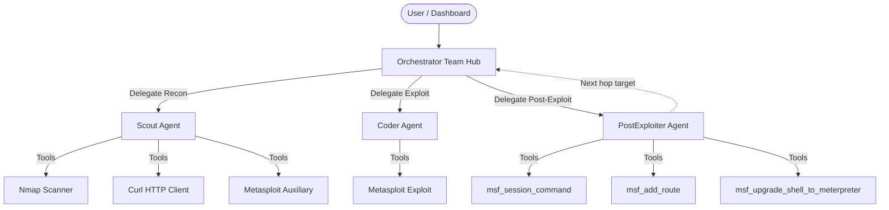

# THESEUS — AI Offensive Security Framework

**THESEUS** (Target-aware Hierarchical Exploit-chain Search and Execution for Unattended Security-testing) is an automated, AI-driven offensive security framework (AI Agentic Pentesting) built using **Agno** (formerly Phidata). The framework is designed to automate reconnaissance, vulnerability analysis, exploitation, post-exploitation, and multi-hop pivoting phases within controlled security environments.

The framework utilizes a local LLM (DeepSeek V4 Flash) served by the local inference provider **DwarfStar** running on the DGX Spark, and interacts via RPC with a **Metasploit Framework** (v6.4.0-dev) instance running in Docker.

---

## Multi-Agent Architecture

The **THESEUS** framework implements a four-agent structure coordinated in **Team** mode:



### 1. Orchestrator (Stateful Strategic Hub)
The administrator of the multi-hop attack chain. It maintains the full **attack graph state** (compromised hosts, active sessions, discovered subnets, pivot routes) and drives the attack loop autonomously:
* **Tools**: `akg_set_campaign`, `akg_list_campaigns`, `akg_get_current_campaign`, `akg_restore_sessions`, `akg_log_decision`, `akg_get_context`, `akg_get_next_targets`, `akg_add_host`, `akg_add_subnet`, `akg_set_phase_status`, `orchestrator_discover_subnet`.
* **Workflow**:
  1. Discover target subnets via `orchestrator_discover_subnet` and initialize campaign context.
  2. Delegate recon to **Scout** for one concrete host at a time.
  3. Delegate exploitation to **Coder** -> get `session_id`.
  4. Delegate post-exploitation to **PostExploiter** -> get credentials, privesc, next hop candidates.
  5. Add pivot routes, update phase status with `akg_set_phase_status`, and repeat for next hop or generate final report.

### 2. Scout Agent (Stateless Reconnaissance — read-only by design)
Specialized in mapping and fingerprinting the perimeter and internal pivot targets. Enforced read-only: has no exploit tools and its instructions explicitly prohibit exploit execution.
* **Tools**: `nmap_scan`, `curl_request`, `msf_search_modules`, `msf_get_module_info`, `msf_execute_scanner`, `get_network_interfaces`, `akg_add_service`, `akg_add_subnet`, `akg_add_host`, `akg_add_credential`.
* **Hop 1**: Full recon using unprivileged Nmap + Curl + MSF auxiliary scanners.
* **Hop 2+**: Uses `msf_execute_scanner` — nmap/curl cannot reach isolated internal hosts directly, but MSF auxiliary modules route transparently through the established pivot.
* **Automatic Loot Capture**: `msf_execute_scanner` automatically snapshots and extracts files saved in `/root/.msf4/loot/` (e.g. traversal / file read findings).

### 3. Coder Agent (Stateless Exploit Automation)
The tactical developer and executor focused on turning confirmed evidence into authorized access with the fewest attempts.
* **Tools**: `msf_trigger_exploit_auto`, `msf_search_modules`, `msf_get_module_info`, `msf_get_best_payload`, `msf_trigger_exploit`, `msf_trigger_local_exploit`, `msf_execute_scanner`, `msf_login`, `execute_python_code`, `get_lhost_for_target`, `akg_record_exploit`, `akg_restore_sessions`, `akg_add_credential`.
* **Workflow**:
  1. **Priority 1**: Known valid credentials -> `msf_login` when supported.
  2. **Priority 2**: Pre-exploit computation -> `execute_python_code` (e.g. token generation, hash cracking, payload encoding).
  3. **Priority 3 (Local PrivEsc)**: Executes `msf_trigger_local_exploit` against an existing low-privilege session.
  4. **Priority 4 (Remote Exploit)**: Always calls `msf_trigger_exploit_auto(module_path, rhosts, rport)` first without manual payloads.
  5. **Fallback**: If auto fails, uses `msf_get_module_info` / `msf_get_best_payload` and retries with `msf_trigger_exploit(extra_options=...)`.
  6. On success, reports `session_id`, records to AKG via `akg_record_exploit`, and stops immediately.

### 4. PostExploiter Agent (Stateless Post-Exploitation & Pivoting)
Operates from inside a compromised session to enumerate the host, harvest credentials, escalate privileges, and prepare the next hop.
* **Tools**: `msf_session_command`, `msf_add_route`, `msf_discover_hosts`, `msf_upgrade_shell_to_meterpreter`, `msf_trigger_local_exploit`, `msf_search_modules`, `msf_get_module_info`, `akg_add_interface`, `akg_add_credential`, `akg_add_pivot`, `akg_add_host`, `akg_add_subnet`, `akg_restore_sessions`, `akg_get_context`.
* **Workflow**:
  1. **Identity & System**: `whoami`, `id`, `uname -a`, `hostname`.
  2. **Network discovery**: `ip addr`, `ip route`, `arp -a` -> discovers internal subnets and interfaces (`akg_add_interface`).
  3. **Credentials & Flags**: reads config files, dumps `env` / shadow files, records flags immediately via `akg_add_credential(cred_type="flag", secret="...")`.
  4. **Privilege Escalation**: checks `sudo -l`, `sudo -V`, SUID binaries. If a known local exploit exists, inspects via `msf_search_modules` / `msf_get_module_info` and fires `msf_trigger_local_exploit(module_path, session_id)`.
  5. **Session Upgrades**: executes `msf_upgrade_shell_to_meterpreter` when interactive shell sessions need to be promoted for Layer 3 routing.
  6. **Pivot setup**: calls `msf_add_route` and `msf_discover_hosts` (`akg_add_pivot`).
* **Returns** a structured report to the Orchestrator.

---

## Multi-Hop Attack Chain

```
[Hop 1]
  Scout(target_1)          -> external recon (nmap + curl + msf aux)
  Coder(target_1)          -> exploit -> session_1 (auto-promoted to Meterpreter)
  PostExploiter(session_1) -> enumerate host, discover 10.10.0.0/24, add MSF route
                           -> finds target_2 at 10.10.0.5

[Hop 2]
  Scout(target_2)          -> internal recon via pivot (msf aux only)
  Coder(target_2)          -> exploit via pivot -> session_2
  PostExploiter(session_2) -> enumerate host, no new subnets found

[Final Report]
  Full chain: target_1 -> session_1 -> target_2 -> session_2
  Credentials harvested, topology mapped, escalation vectors listed
```

---

## Attack Knowledge Graph (AKG) & Local Web Dashboard

The framework constructs an **Attack Knowledge Graph (AKG)** in real-time as the attack progresses. It maps the network topology, discovered hosts, open services, obtained credentials, and successful exploits.

### Graph Schema & Nodes
The graph consists of the following components:
* **Nodes**:
  * `Subnet`: Networks (e.g., `172.28.0.0/16`, `172.30.0.0/16`). Subnets are automatically merged and managed to prevent overlapping duplicates.
  * `Host`: Devices discovered on the network (e.g., `172.28.0.5`).
  * `Interface`: Network interfaces belonging to hosts (e.g., `eth0`, `eth1`).
  * `Service`: Open ports and banners discovered on hosts (e.g., `172.28.0.5:80`).
  * `ExploitStep`: Successful exploit sessions established by the Coder agent.
  * `Credential`: Credentials found on compromised hosts (e.g., database passwords, environment hashes, CTF flags).
* **Edges**:
  * `CONTAINS`: Connects a `Subnet` to a contained `Host` or a `Host` to its internal assets.
  * `HAS_INTERFACE`: Links a `Host` to its network `Interface`.
  * `CONNECTS_TO`: Connects an `Interface` to a `Subnet`.
  * `RUNS`: Connects a `Host` to an active `Service`.
  * `EXPLOITED_VIA`: Links a `Service` to a successful `ExploitStep`.
  * `COMPROMISES`: Connects an `ExploitStep` to the target `Host`.
  * `YIELDS`: Links an `ExploitStep` to a retrieved `Credential`.
  * `PIVOTS_INTO`: Connects an `ExploitStep` to a `Subnet` used as a pivot.

The graph is automatically saved as a JSON structure at `campaigns/<campaign_id>/graph.json`.

### Service Node — Extended Fields
The `Service` node carries properties populated by Scout at reconnaissance time:

| Property | Example value | How extracted | Used by |
|---|---|---|---|
| `target_os` | `"linux"` | nmap OS detection or banner (`Debian` -> `linux`) | Coder: payload platform selection |
| `target_arch` | `"x64"` | nmap service field or banner (`x86_64`/`amd64` -> `x64`) | Coder: 32-bit vs 64-bit payload |

The Orchestrator propagates these fields to the Coder so that `msf_get_best_payload` can score candidates with full OS+arch context.

---

## Tool Matrix — Agent Privilege Table

Each agent only receives the tools strictly required for its role (principle of least privilege). The table below is the authoritative reference for tool assignments.

| Tool | Signature | Scout | Coder | PostExploiter | Orchestrator | Purpose |
|------|-----------|:-----:|:-----:|:-------------:|:------------:|---------|
| `nmap_scan` | `(target, ports, arguments)` | Yes | No | No | No | Native port scan via Docker/Nmap (`--unprivileged -sT -Pn`), returns open ports, services, OS guesses |
| `curl_request` | `(url, method, headers, data, ...)` | Yes | No | No | No | HTTP/HTTPS fingerprinting — server banners, headers, body preview |
| `msf_search_modules` | `(keyword)` | Yes | Yes | Yes | No | Search Metasploit module DB by keyword, CVE, or description |
| `msf_get_module_info` | `(module_type, module_name)` | Yes | Yes | Yes | No | Inspect module options, required parameters, and targets |
| `msf_execute_scanner` | `(module_path, rhosts, rport, extra_options)` | Yes | Yes | No | No | Run an `auxiliary/` module via MSF RPC with automatic loot capture |
| `get_network_interfaces` | `()` | Yes | No | No | No | Attacker interface map (bridges, VPNs, Docker networks) |
| `msf_trigger_exploit_auto` | `(module_path, rhosts, rport)` | No | Yes | No | No | Mandatory first exploit attempt with target port and module defaults |
| `msf_get_best_payload` | `(module_path, banner, target_os, target_arch, prefer_meterpreter)` | No | Yes | No | No | Queries MSF compatible payloads and applies multi-criteria scoring |
| `msf_trigger_exploit` | `(module_path, rhosts, rport, payload, lhost, extra_options)` | No | Yes | No | No | Executes remote `exploit/` module with custom options/payloads |
| `msf_trigger_local_exploit` | `(module_path, session_id, payload, lhost, extra_options)` | No | Yes | Yes | No | Executes local privilege escalation exploit (`exploit/*/local/*`) on active session |
| `msf_login` | `(protocol, rhosts, rport, username, password)` | No | Yes | No | No | Automated credential authentication (SSH, FTP, etc.) via MSF scanners |
| `execute_python_code` | `(code)` | No | Yes | No | No | Executes Python scripts locally or in attacker environment (sniffing, crypto, tokens) |
| `get_network_environment` | `()` | No | Yes | No | No | Returns attacker interfaces (name, MAC) and ARP cache table before writing network scripts |
| `get_lhost_for_target` | `(target_ip)` | No | Yes | No | No | Resolves optimal LHOST for a specific target via routing |
| `msf_session_command` | `(session_id, command, timeout)` | No | No | Yes | No | Executes command on active MSF session (shell or Meterpreter) |
| `msf_upgrade_shell_to_meterpreter` | `(session_id, lhost, lport, timeout, close_original_shell)` | No | No | Yes | No | Promotes active shell session to Meterpreter |
| `msf_add_route` | `(session_id, subnet, netmask)` | No | No | Yes | No | Adds pivot route in Metasploit routing table |
| `msf_discover_hosts` | `(subnet)` | No | No | Yes | No | Internal host discovery via pivot routes |
| `akg_add_host` | `(ip, hostname, os, subnet_cidr)` | Yes | No | Yes | Yes | Registers target and adjacent hosts into AKG |
| `akg_add_subnet` | `(cidr, is_attacker_network)` | Yes | No | Yes | Yes | Records discovered subnets and network boundaries |
| `akg_add_service` | `(host_ip, port, proto, service_name, banner, ...)` | Yes | No | No | No | Records discovered port, service, banner, and CVEs into AKG |
| `akg_record_exploit` | `(session_id, host_ip, port, exploit_module, ...)` | No | Yes | No | No | Records exploit execution and session establishment into AKG |
| `akg_add_interface` | `(host_ip, iface_name, iface_ip, subnet_cidr, mac)` | No | No | Yes | No | Records host network interfaces and internal IP mappings |
| `akg_add_credential` | `(exploit_session_id, cred_type, label, location, username, secret)` | Yes | Yes | Yes | No | Records harvested credentials, hashes, secrets, and CTF flags |
| `akg_add_pivot` | `(exploit_session_id, subnet_cidr, route)` | No | No | Yes | No | Records established pivot edges connecting sessions to subnets |
| `akg_restore_sessions` | `(campaign_id)` | No | Yes | Yes | Yes | Re-executes exploit chains to resurrect dropped sessions and pivot routes |
| `akg_get_context` | `(campaign_id)` | No | No | Yes | Yes | Queries attack graph context, summary metrics, and target states |
| `akg_set_campaign` / `akg_list_campaigns` / `akg_get_current_campaign` | `(...)` | No | No | No | Yes | Strategic campaign management and campaign selection |
| `akg_get_next_targets` / `akg_set_phase_status` / `akg_log_decision` | `(...)` | No | No | No | Yes | Phase progression tracking, next target resolution, and decision logging |
| `orchestrator_discover_subnet` | `(subnet_cidr)` | No | No | No | Yes | Discovers live hosts across a subnet via Kali container |

### Design Notes

- **Scout is strictly read-only**: it has no exploit or session-modifying tools. It cannot execute destructive actions or local privilege escalation.
- **Coder is dedicated to access**: equipped with `msf_trigger_exploit_auto` for zero-guess initial exploits, `execute_python_code` for pre-exploit crypto/tokens, and `msf_trigger_local_exploit` for privilege escalation.
- **PostExploiter has local privesc capability**: can search and inspect modules (`msf_search_modules`, `msf_get_module_info`) and trigger local exploits (`msf_trigger_local_exploit`) directly on unprivileged sessions.
- **Flag Recording**: all agents with secret/flag discovery capability (`Scout`, `Coder`, `PostExploiter`) have `akg_add_credential` to register flags with `cred_type="flag"` and `secret="<FLAG_VALUE>"`.
- **`akg_restore_sessions` assignment**: available to **Coder**, **PostExploiter**, and **Orchestrator** to re-heal dropped pivots and exploit sessions automatically.
- **`get_network_interfaces` vs `get_lhost_for_target`**: each agent receives scoped network views appropriate to its function.
- **Attack Surface Telemetry Hook (`core/hooks.py`)**: All agents and the Orchestrator Team are wired with `tool_hooks=[attack_surface_tool_hook]`. This global telemetry hook intercepts and counts only the tool executions that directly interact with the target environment and attack surface (`nmap_scan`, `curl_request`, `msf_*`, `execute_python_code`, `orchestrator_discover_subnet`). Internal AKG graph operations (`akg_*`) are strictly excluded from the count.
- **Guard layers in `tools.py`**: `msf_execute_scanner` rejects non-auxiliary modules; `msf_trigger_exploit` rejects non-exploit modules.
- **Automatic Loot Capture**: `msf_execute_scanner` automatically snapshots `/root/.msf4/loot/` to capture and parse file read / directory traversal loot.

---

## Work in Progress: Automated Shell-to-Meterpreter Upgrade & Layer 3 Pivoting

Metasploit Layer 3 routing (`post/multi/manage/autoroute` and MSF auxiliary network/port scanners) requires a session capable of packet forwarding (Meterpreter or SSH). Standard Unix shell sessions cannot forward raw L3 TCP packets across subnets.

### Current Implementation & Roadmap:
1. **Dynamic Shell-to-Meterpreter Promotion (`msf_upgrade_shell_to_meterpreter`)**:
   - Implemented via `post/multi/manage/shell_to_meterpreter`.
   - Automatically determines `LHOST` by inspecting `tunnel_local` on the established pivot connection.
   - Automatically re-registers new session IDs and session types in the Attack Knowledge Graph (`ExploitStep` nodes and `PIVOTS_INTO` edges).
   - Automatically closes stale shell sockets to prevent resource leaks.
2. **Transparent Exploit Promotion**:
   - `msf_trigger_exploit` executes automated promotion upon landing a raw shell payload and returns the upgraded Meterpreter session directly to the Coder.
3. **Auto-healing Route Insertion (`msf_add_route`)**:
   - If `msf_add_route` is called on a shell session, it automatically promotes the session to Meterpreter before calling `autoroute`.
4. **Resilience & Session Restoring (`akg_restore_sessions`)**:
   - When dropped sessions are restored from the AKG history, the promotion stage and all established pivot routes are automatically replayed.

---

## Requirements & Setup

### 1. Prerequisites
* **Python 3.11+** and **uv** package manager installed.
* **Docker** active to run Metasploit and target machines.
* Access to a local LLM (default: `deepseek-v4-flash q2` on `http://127.0.0.1:8000/v1`).
* Metasploit RPC daemon running (`msfrpcd`) — **Metasploit Framework v6.4.0-dev**.

### 2. First-Run Setup (Recommended)
On first install, run the interactive wizard:
```bash
uv run setup.py
```

### 3. Manual Configuration (Advanced)
```bash
cp config.template.py config.py
# then edit config.py with your values
```

---

## Running the Project

### 1. Preflight Test
```bash
uv run setup/preflight.py
```

### 2. Run in CLI Mode (Terminal)
```bash
uv run main.py
```

### 3. Run with Online Dashboard (AgentOS)
```bash
uv run serve.py
```
Connect via [https://os.agno.com/](https://os.agno.com/) to endpoint `http://localhost:7777`.

### 4. Run with Local Web Dashboard (D3.js Visualization)
```bash
uv run dashboard.py
```
Open `http://localhost:8890` in your browser.

---

## Testing

The framework includes a fully mocked unit test suite — **no Metasploit, no Docker, no live network required**.

```bash
# Run all tests (120 tests)
uv run pytest

# Verbose output with test names
uv run pytest -v

# Specific test files
uv run pytest tests/test_tools.py
uv run pytest tests/test_agents.py
uv run pytest tests/test_rpc_client.py
uv run pytest tests/test_payload_selection.py
uv run pytest tests/test_akg_service_recon.py
```

### Test Coverage Summary

| Component | Test File | Description |
|---|---|---|
| Tools & Handlers | `tests/test_tools.py` | Input guards, output parsing, error handling, session verification |
| Agent Configuration | `tests/test_agents.py` | Role-based tool assignments, system prompts, memory settings |
| Metasploit RPC | `tests/test_rpc_client.py` | Msgpack serialization, authentication token rotation, connection pooling |
| Payload Selection | `tests/test_payload_selection.py` | Zero-heuristic scoring, architecture matching, fallbacks |
| AKG & Service Recon | `tests/test_akg_service_recon.py` | Graph synchronization, session restoration, parameter resolution |

---

## Target Environment Configuration (Lab)

To test the framework safely, you can spin up preconfigured vulnerable containers inside the Docker bridge network:

### 1. Drupal 8.5.0 (Vulnerable to Drupalgeddon2 - RCE)
```bash
docker run -d --name drupal-vuln -p 8082:80 drupal:8.5.0-apache
```
* **Metasploit Module**: `exploit/multi/http/drupal_drupaldgeddon2`
* **PostExploiter Target**: Reads `/var/www/html/sites/default/settings.php` to extract MySQL credentials.

### 2. OWASP Juice Shop (Web Vulnerability Training)
```bash
docker run -d --name juice-shop -p 3000:3000 bkimminich/juice-shop
```

---

## Example Execution Walkthrough (Multi-Hop Attack Campaign)

Below is an end-to-end trace from an autonomous campaign execution (`dm-07-08`) orchestrated by THESEUS, demonstrating multi-hop pivoting, reconnaissance, exploit selection, and post-exploitation credential harvesting across isolated subnets.

### Network Topology

```text
[Attacker C2]
      │
      ▼ Attacker-Facing Subnet: 172.28.0.0/16
┌─────────────────────────────────────────────────────────┐
│ Target 1 (Hop 1): 172.28.0.5 (Drupal 8)                │
│ Interface eth0: 172.28.0.5/16 (Attacker Facing)         │
│ Interface eth1: 172.30.0.5/16 (Internal Facing)         │
└─────────────────────────────────────────────────────────┘
      │
      ▼ Layer 3 Pivot Route: 172.30.0.0/16 via Session 1
┌─────────────────────────────────────────────────────────┐
│ Target 2 (Hop 2): 172.30.0.10 (Metasploitable 2)       │
│ Interface eth0: 172.30.0.10/16                          │
└─────────────────────────────────────────────────────────┘
```

### Hop 1 — Target 172.28.0.5 (External Perimeter)

1. **Scout Agent (Reconnaissance)**:
   - Scanned the external perimeter host (`172.28.0.5`) using Nmap and Curl.
   - Identified open port `80/tcp` (HTTP) with banner: `Apache/2.4.25 (Debian) - PHP/7.2.3 - Drupal 8`.
   - Attributed vulnerability: `CVE-2018-7600` (Drupalgeddon2) and recorded the service into the Attack Knowledge Graph (`akg_add_service`).

2. **Coder Agent (Exploitation)**:
   - Queried Metasploit module database and selected `exploit/unix/webapp/drupal_drupalgeddon2`.
   - Selected optimal payload via the scoring engine and fired the exploit.
   - Established **Session 1** with privilege `www-data` and recorded the execution step into the AKG (`akg_record_exploit`).

3. **PostExploiter Agent (Post-Exploitation & Pivoting)**:
   - **Host Enumeration**: Extracted interface mappings (`eth0: 172.28.0.5/16`, `eth1: 172.30.0.5/16`), identifying the dual-homed configuration and the internal subnet `172.30.0.0/16`.
   - **Pivot Setup**: Configured Layer 3 routing rule `172.30.0.0/255.255.0.0` via Session 1 (`msf_add_route`), establishing the pivot edge in the AKG (`akg_add_pivot`).
   - **Host Discovery**: Discovered adjacent internal host `172.30.0.10` (`akg_add_host`).
   - **Credential Harvesting**: Extracted 3 secrets from application files and environment variables:
     - Drupal Hash Salt: `0Yd6yJ0rVSjoS1v5E2bmNcfqkDNxJ31a74tghZlo5PpYCECTs1UgPzrhj_6nK4pixEccwzWLvw` (from `/var/www/html/sites/default/settings.php`).
     - MD5 Secret: `5679d3fa188fb80368ee46ab40acdb6b` (from `env`).
     - SQLite Database Path: `sites/default/files/.ht.sqlite`.

---

### Hop 2 — Target 172.30.0.10 (Internal Network via Pivot)

1. **Scout Agent (Internal Reconnaissance via Pivot)**:
   - Executed Metasploit auxiliary scanners through the `172.30.0.0/16` pivot tunnel.
   - Mapped 13 active internal services on `172.30.0.10`:
     - Port 21/tcp: FTP (`vsFTPd 2.3.4`, `CVE-2011-1002`)
     - Port 22/tcp: SSH (`OpenSSH 4.7p1`)
     - Port 23/tcp: Telnet (`msfadmin login`)
     - Port 25/tcp: SMTP (`Postfix`)
     - Port 80/tcp: HTTP (`Apache 2.2.8 / PHP 5.2.4`)
     - Port 111/tcp: RPC (`SunRPC`)
     - Ports 139/tcp & 445/tcp: **Samba 3.0.20-Debian**
     - Ports 512/tcp (rexec), 513/tcp (rlogin), 514/tcp (rsh)
     - Port 3306/tcp: MySQL (`5.0.51a`)
     - Port 5432/tcp: PostgreSQL

2. **Coder Agent (Exploitation via Pivot)**:
   - Selected exploit module `exploit/multi/samba/usermap_script` targeting Samba on port 139.
   - Successfully executed through the pivot route, establishing **Session 3** with full **`root`** privileges.

3. **PostExploiter Agent (Deep Enumeration & Credential Extraction)**:
   - **Shadow File Dump (7 Password Hashes)**:
     - `root`: `$1$/avpfBJ1$x0z8w5UF9Iv./DR9E9Lid.`
     - `msfadmin`: `$1$XN10Zj2c$Rt/zzCW3mLtUWA.ihZjA5/`
     - `user`: `$1$HESu9xrH$k.o3G93DGoXIiQKkPmUgZ0`
     - `service`: `$1$kR3ue7JZ$7GxELDupr5Ohp6cjZ3Bu//`
     - `postgres`: `$1$Rw35ik.x$MgQgZUuO5pAoUvfJhfcYe/`
     - `metasploit`: `$1$Az$kf0BaRSqaSF9ewhqk5sMa.`
   - **SSH Key Harvesting**:
     - Extracted complete RSA private key (`/home/msfadmin/.ssh/id_rsa`).
     - Extracted authorized public keys (`/root/.ssh/authorized_keys`).
   - **Database Dumps (MySQL `dvwa.users` - 5 Hashes)**:
     - `admin`: `5f4dcc3b5aa765d61d8327deb882cf99` (plaintext: `password`)
     - `smithy`: `5f4dcc3b5aa765d61d8327deb882cf99`
     - `gordonb`: `e99a18c428cb38d5f260853678922e03`
     - `1337`: `8d3533d75ae2c3966d7e0d4fcc69216b`
     - `pablo`: `0d107d09f5bbe40cade3de5c71e9e9b7`

---

### Campaign Execution Metrics

| Metric | Result |
|---|---|
| **Target Hosts Compromised (PWNED)** | **2 / 2 hosts** (`172.28.0.5` with `www-data`, `172.30.0.10` with `root`) |
| **Subnets Discovered & Mapped** | 2 (`172.28.0.0/16`, `172.30.0.0/16`) |
| **Services Profiled** | 14 services |
| **Credentials & Secrets Harvested** | **16 credentials** (shadow hashes, RSA private keys, DB secrets, web tokens) |
| **Pivots Established** | 1 full multi-hop pivot chain via Session 1 |

---

## Technical Details

* **Lazy RPC Proxy**: `rpc_client.py` uses a lazy-loading pattern. If Metasploit is offline at startup, the framework will not crash until an MSF tool is invoked.
* **Recursive Msgpack Decoding**: All Msgpack payloads received from Metasploit RPC are recursively decoded into UTF-8 strings by `rpc_client.py`.
* **Session Type Detection**: `msf_session_command` automatically detects whether the active session is a generic shell or Meterpreter, and uses the appropriate RPC method (`session.shell_write/read` vs `session.meterpreter_run_single/read`).
* **Pivot Routing**: `msf_add_route` registers subnets into Metasploit's IPv4 routing table via Meterpreter sessions. All subsequent MSF auxiliary and exploit modules route through the pivot session.
